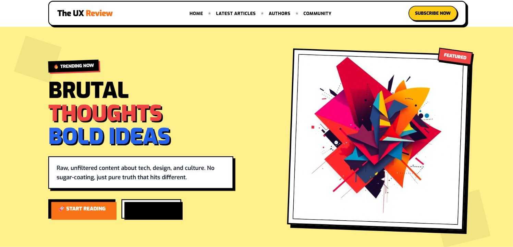
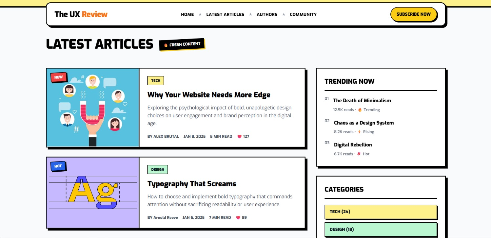
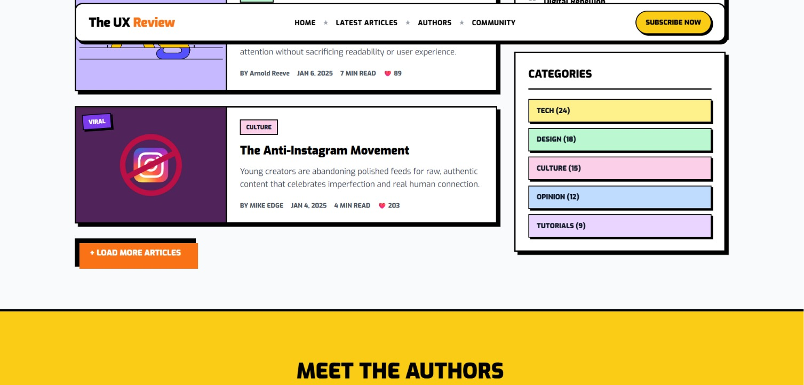
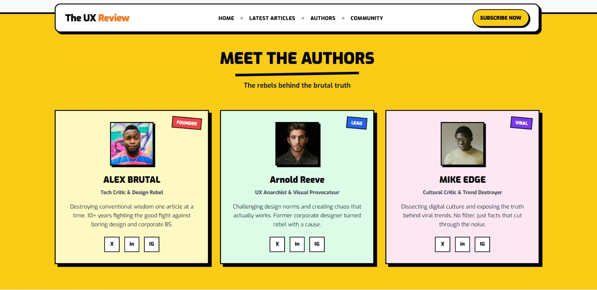
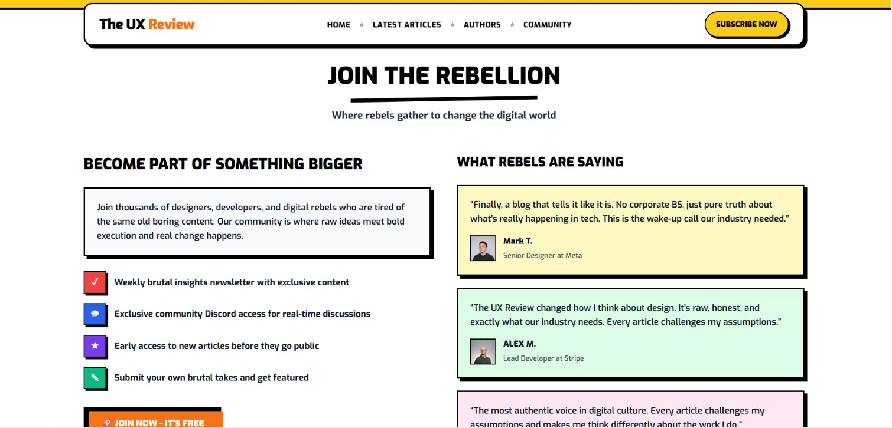

# 📰 The UX Review | Editorial Website

A responsive editorial website built with HTML5 and CSS3, featuring a bold visual identity, expressive typography, and a modern magazine-style layout.

The UX Review explores design, technology, digital culture, and creative ideas through a visually engaging reading experience.

## 🌐 Live Demo

[View Live Website](https://sandy-mohamed.github.io/The-UX-Review/)

## Screenshots

### Hero


### Latest Articles


### Articles and Categories


### Meet the Authors


### Join the Community


## ✨ Features

- Modern editorial and magazine-style design
- Bold typography and expressive visual elements
- Featured articles and latest stories section
- Trending articles sidebar
- Article category navigation
- Author profiles and social media links
- Community and newsletter sections
- Responsive page layout
- Custom styling and hover effects

## 🛠️ Technologies Used

- **HTML5** — Semantic page structure
- **CSS3** — Custom styling and responsive design
- **Google Fonts** — Exo typography

## 📁 Project Structure

```text
The-UX-Review/
├── index.html
├── css/
│   └── style.css
└── images/
    └── [website image assets]
```

## 📌 Main Sections

- **Home** — Hero section introducing the website
- **Latest Articles** — Featured editorial content
- **Trending Now** — Highlighted stories
- **Categories** — Design, technology, culture, opinion, and tutorials
- **Meet the Authors** — Contributor profiles
- **Community** — Community highlights
- **Newsletter** — Subscription interface

## ⚙️ Project Notes

This is a front-end website built to demonstrate HTML, CSS, responsive layouts, and editorial UI design.

The newsletter form and load-more button are interface demonstrations and are not connected to a backend service.

## 🚀 Getting Started

1. Clone or download this repository.
2. Open the project folder.
3. Launch `index.html` in your browser.
4. Explore the editorial layout and website sections.

## 👩‍💻 Developer

**Sandy Mohamed**

Front-End Developer

[GitHub Profile](https://github.com/sandy-mohamed)
